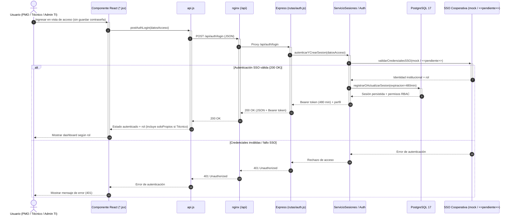
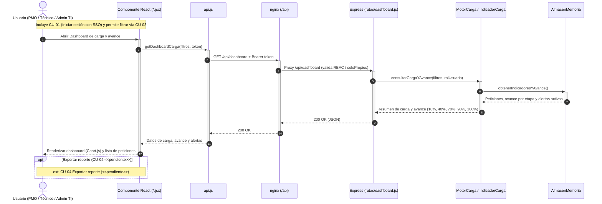
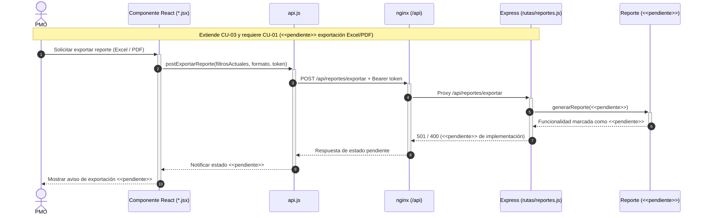
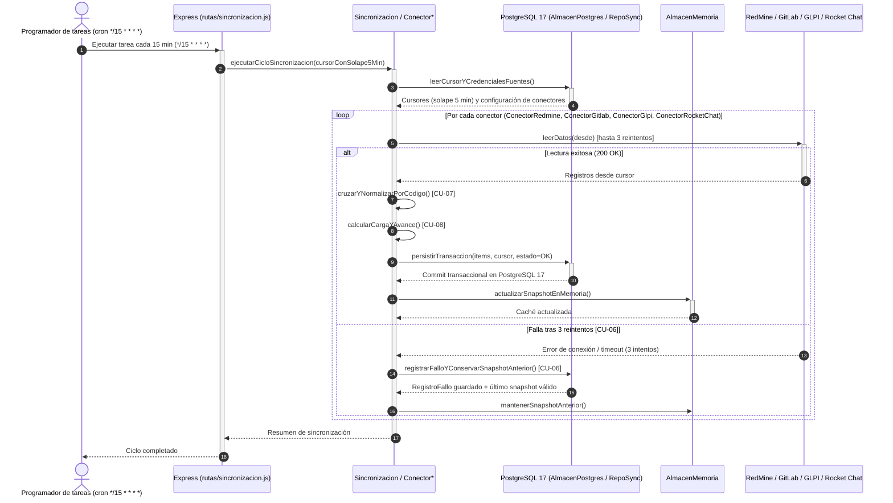
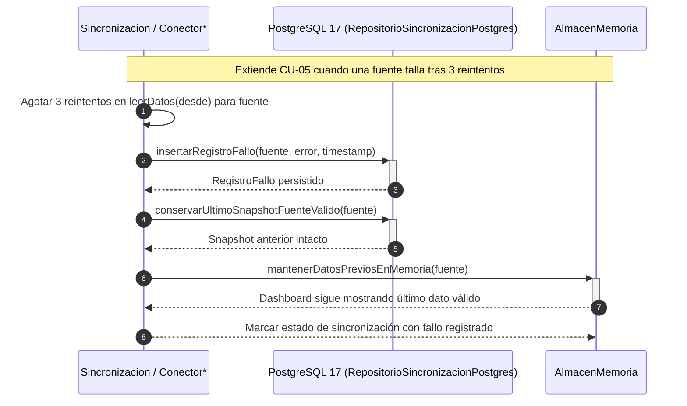
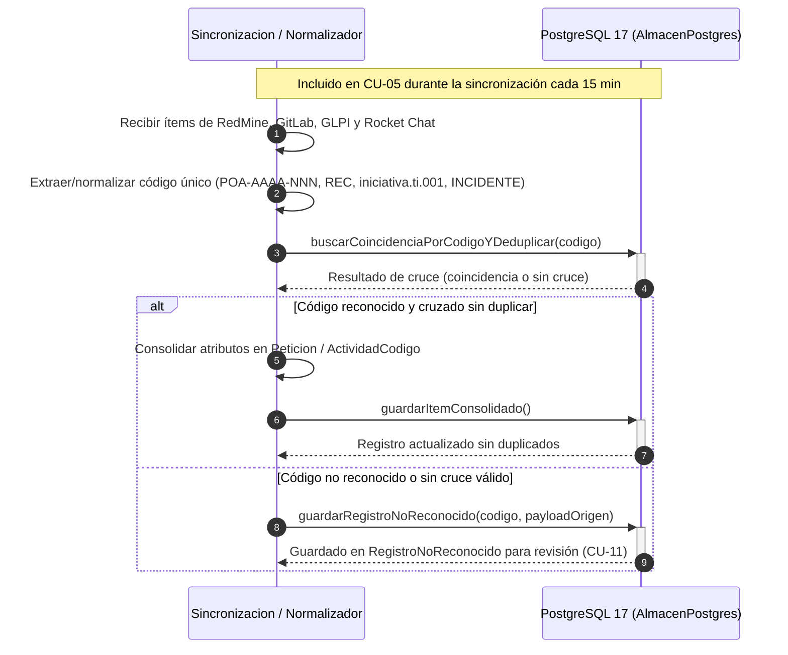
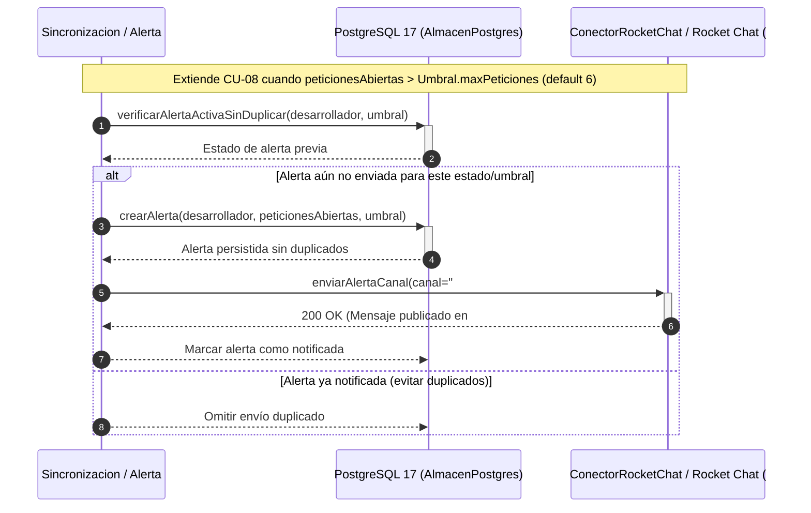
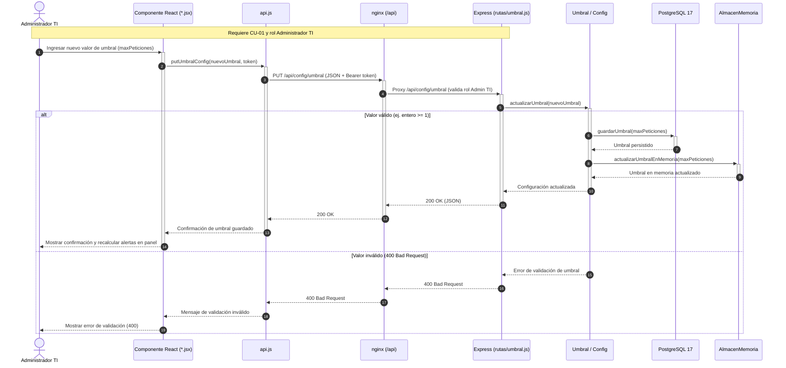
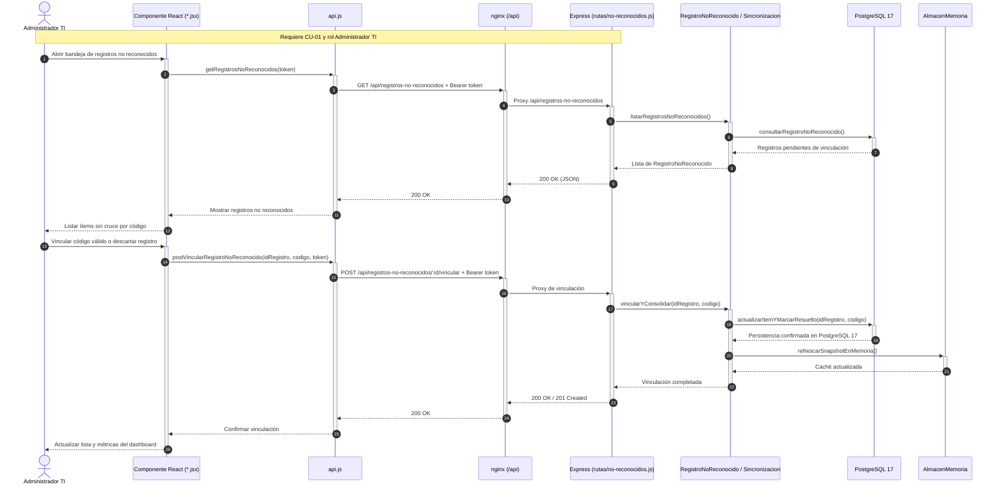

# Diagramas de Secuencia

## CU-01: Iniciar sesión con SSO



---

## CU-02: Filtrar información

```mermaid
sequenceDiagram
    autonumber
    actor User as Usuario (PMO / Técnico / Admin TI)
    participant UI as Componente React (*.jsx)
    participant Api as api.js
    participant Nginx as nginx (/api)
    participant Express as Express (rutas/carga.js)
    participant Negocio as Filtro / MotorCarga
    participant Cache as AlmacenMemoria

    Note over User,Express: Requiere CU-01 (Bearer token válido; si es Técnico aplica restricción soloPropios)

    User->>+UI: Seleccionar filtros (desarrollador, tipo, etapa, proyecto, fuente, fechas)
    UI->>+Api: getCargaFiltrada(parametrosFiltro, token)
    Api->>+Nginx: GET /api/carga?... + Bearer token
    Nginx->>+Express: Proxy /api/carga + validar token/rol
    Express->>+Negocio: aplicarFiltros(criterios, soloPropios)
    Negocio->>+Cache: leerSnapshotEnMemoria()
    Cache-->>-Negocio: Ítems e indicadores en memoria
    Negocio-->>-Express: Colección filtrada + métricas recalculadas
    Express-->>-Nginx: 200 OK (JSON filtrado)
    Nginx-->>-Api: 200 OK
    Api-->>-UI: Datos filtrados para gráficos (Chart.js) y tablas
    UI-->>-User: Actualizar vista filtrada
```

---

## CU-03: Consultar dashboard de carga y avance



---

## CU-04: Exportar reporte (<<pendiente>>)



---

## CU-05: Sincronizar fuentes (cron */15 * * * *)



---

## CU-06: Registrar fallo de fuente



---

## CU-07: Cruzar datos por código



---

## CU-08: Calcular carga y avance

```mermaid
sequenceDiagram
    autonumber
    participant Sync as Sincronizacion / IndicadorCarga
    participant DB as PostgreSQL 17 (AlmacenPostgres)

    Note over Sync,DB: Incluido en CU-05; sin priorización algorítmica

    Sync->>+DB: consultarPeticionesAbiertasYEtapas(desarrollador, umbral)
    DB-->>-Sync: Peticiones abiertas, etapa actual y Umbral.maxPeticiones (default 6)
    Sync->>Sync: Estimar avance por etapa (ANALISIS 10%, DESARROLLO 40%, CERTIFICACION 70%, DESPLIEGUE 90%, ESTABILIZACION 100%)
    Sync->>Sync: Calcular carga (conteo peticiones abiertas; sin algoritmo de priorización)
    Sync->>+DB: guardarIndicadorCarga(carga, avanceEstimado)
    DB-->>-Sync: IndicadorCarga actualizado

    alt peticionesAbiertas > Umbral.maxPeticiones (default 6)
        Sync->>Sync: Disparar condición de alerta [CU-09]
        Note over Sync,DB: ext: CU-09 Enviar alerta
    end
```

---

## CU-09: Enviar alerta



---

## CU-10: Configurar umbral



---

## CU-11: Revisar registros no reconocidos



---

